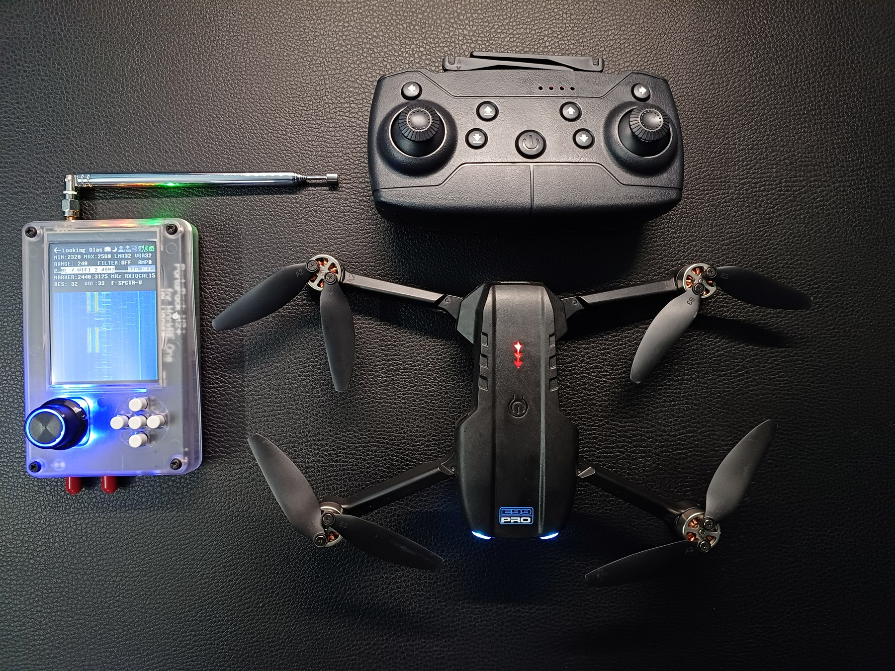
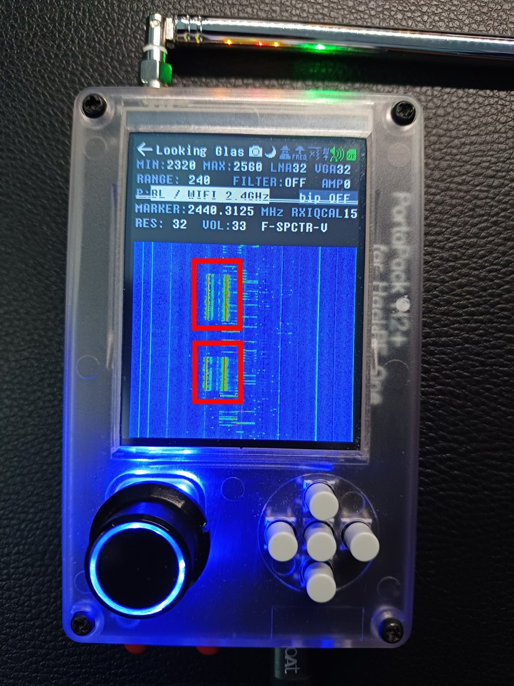

<div align="center">

# 🚁 Drone RF Security Research — Signal Interception, Replay & Jamming

### Analysing the 2.4 GHz wireless attack surface of a consumer UAV with HackRF One + PortaPack H2+ (Mayhem)

[](https://greatscottgadgets.com/hackrf/)
[](https://github.com/portapack-mayhem/mayhem-firmware)
[](https://github.com/portapack-mayhem/mayhem-firmware)
[](#-target--environment)
[](#)
[](DISCLAIMER.md)
[](LICENSE)

</div>

---

> ⚠️ **Ethical & Legal Notice** — This project documents a **hands-on RF security experiment performed on hardware I personally own, in a controlled environment, at low power.** It is published for **education and defensive research only.** Intercepting, replaying, or jamming radio signals you are not authorized to touch is **illegal in most jurisdictions** (e.g. intentional jamming violates the US *Communications Act* and equivalent laws worldwide). **Read the full [DISCLAIMER](DISCLAIMER.md) before using anything here.**

---

## 📑 Table of Contents

- [Overview](#-overview)
- [Hardware & Software Stack](#-hardware--software-stack)
- [Target & Environment](#-target--environment)
- [Methodology](#-methodology)
- [Demonstration](#-demonstration)
- [Captured Evidence](#-captured-evidence)
- [Key Findings](#-key-findings)
- [Security Implications & Mitigations](#-security-implications--mitigations)
- [Repository Structure](#-repository-structure)
- [Detailed Documentation](#-detailed-documentation)
- [Disclaimer](#-disclaimer)
- [Author](#-author)

---

## 🔍 Overview

Most consumer and hobby-grade drones communicate with their controllers over the **2.4 GHz ISM band** using unencrypted, unauthenticated protocols. This project explores that attack surface end-to-end using a **Software-Defined Radio (SDR)** workflow built around the **HackRF One** and the **PortaPack H2+** running **Mayhem firmware**.

The research walks through the full RF attack kill-chain against a drone's control link:

| Phase | Technique | Outcome |
|-------|-----------|---------|
| 1️⃣ **Reconnaissance** | Wideband spectrum sweep (Looking Glass) | Located control-signal bursts in the 2.4 GHz band |
| 2️⃣ **Interception** | Passive RF capture of controller inputs | Recorded raw transmissions per flight command |
| 3️⃣ **Replay Attack** | Re-transmission of captured packets | Reproduced drone movement **without the original controller** |
| 4️⃣ **Jamming** | Continuous-wave interference on the control band | Disrupted the link → instability / failsafe landing |

The goal is to **demonstrate why robust link-layer security (FHSS + AES, mutual authentication) matters** for UAVs that are increasingly deployed for surveillance, delivery, and critical-infrastructure inspection.

---

## 🎬 Demonstration

**Inline demo clip** *(short, high-level walkthrough):*

<video src="https://github.com/user-attachments/assets/cf5597a7-c546-4113-8a1c-1920bdbd9c0f" width="100%" controls></video>
<br>

**Full demonstration video** *(longer capture, committed to the repo):*
👉 **[`media/video/demo.mp4`](media/video/demo.mp4)** — download or view the complete interception → replay → jamming walkthrough.

---

## 📸 Captured Evidence

<div align="center">

### Full test rig — SDR + controller + target UAV


### Looking Glass — 2.4 GHz waterfall during controller activity


<sub>Looking Glass sweep of the 2.3–2.56 GHz window, with the control-signal bursts (triggered by controller input) highlighted in red.</sub>

</div>

---

## 🛠 Hardware & Software Stack

| Component | Role |
|-----------|------|
| **HackRF One** | Half-duplex SDR transceiver (1 MHz – 6 GHz) — RX capture & TX replay/jam |
| **PortaPack H2+** | Standalone touchscreen host — no laptop required in the field |
| **Mayhem Firmware** | Community firmware adding Looking Glass, Capture, Replay, Jammer & more |
| **Looking Glass** | Wideband spectrum/waterfall analyzer app used for reconnaissance |
| **Telescopic 2.4 GHz antenna** | SMA whip antenna for the ISM band |
| **Target UAV** | Consumer quadcopter (E99 Pro-class) + stock 2.4 GHz controller |

> 📄 Full bill of materials and tuning parameters: **[docs/hardware-setup.md](docs/hardware-setup.md)**

---

## 🎯 Target & Environment

- **Frequency band:** 2.4 GHz ISM (swept window **2320 – 2560 MHz**, `RANGE 240`)
- **Signal of interest marker:** ~**2440.3125 MHz**
- **Modulation (observed):** short, bursty control packets — proprietary 2.4 GHz / Wi-Fi-FHSS style, **no observable encryption**
- **Gain configuration:** `LNA 32 · VGA 32 · AMP 0` (as shown on-device)
- **Environment:** controlled personal test space, minimal RF power, own equipment only

---

## 🧪 Methodology

A concise summary — each phase has its own deep-dive in [`/docs`](docs/).

### 1. Reconnaissance — *Looking Glass sweep*
Swept the 2.3–2.56 GHz window on the PortaPack's Looking Glass. When controller buttons/sticks were actuated, **distinct bright bursts (red/yellow traces)** appeared in the waterfall — the control uplink keying on and off in sync with operator input. → [docs/02-reconnaissance.md](docs/02-reconnaissance.md)

### 2. Interception — *passive capture*
Tuned to the identified center frequency and captured the raw IQ/baseband of the control bursts triggered by specific stick movements. → [docs/01-methodology.md](docs/01-methodology.md)

### 3. Replay Attack
Re-transmitted the previously captured control bursts with the HackRF. The drone **responded to the replayed packets and reproduced movement without the genuine controller transmitting** — confirming the absence of replay protection / rolling codes. → [docs/03-replay-attack.md](docs/03-replay-attack.md)

### 4. Jamming (CW interference)
Emitted continuous-wave interference over the same control band. The link degraded, the drone lost reliable command and **entered instability / forced-landing (failsafe)** behaviour. → [docs/04-jamming.md](docs/04-jamming.md)

---

## 🔑 Key Findings

| # | Finding | Impact |
|---|---------|--------|
| 🟢 | **Passive interception is trivial** — control bursts are clearly visible and capturable with a hobby-grade SDR | Loss of confidentiality of the control channel |
| 🔁 | **Replay attacks succeed** — captured packets reproduce drone movement with no original controller present | No replay protection / no rolling code → **spoofable control** |
| ⚠️ | **CW jamming disrupts the link** — simple same-band interference forces instability / failsafe landing | Trivial denial-of-service against availability |
| ❌ | **No encryption or mutual authentication observed** on the control link | Enables spoofing, hijacking and interference |

---

## 🛡 Security Implications & Mitigations

Consumer UAVs increasingly perform **sensitive roles** — surveillance, delivery, inspection — yet many ship with control links that fail basic security properties. Recommended countermeasures:

- 🔐 **Encrypt the control link** — AES-protected payloads so captured packets can't be understood or forged.
- 🔁 **Replay protection** — rolling codes, nonces, or timestamp/sequence counters so a replayed packet is rejected.
- 🤝 **Mutual authentication** — cryptographic binding between controller and drone to stop spoofed transmitters.
- 📡 **Frequency-Hopping Spread Spectrum (FHSS)** — raises the cost of both interception and jamming.
- 🛰 **Robust failsafe logic** — safe, predictable behaviour (controlled RTH/land) on link loss instead of uncontrolled crash.
- 🧭 **Remote ID & geofencing** — for accountability and airspace safety.

> 📄 Extended analysis: **[docs/05-findings-and-mitigations.md](docs/05-findings-and-mitigations.md)**

---

## 📂 Repository Structure

```text
.
├── README.md                     # You are here
├── DISCLAIMER.md                 # Legal & ethical scope — read first
├── LICENSE                       # MIT (code/docs) + research-use notice
├── CONTRIBUTING.md               # How to contribute responsibly
├── .gitignore
├── docs/
│   ├── 01-methodology.md         # End-to-end SDR workflow
│   ├── 02-reconnaissance.md      # Looking Glass spectrum analysis
│   ├── 03-replay-attack.md       # Capture & replay walkthrough
│   ├── 04-jamming.md             # CW jamming experiment
│   ├── 05-findings-and-mitigations.md
│   ├── hardware-setup.md         # BOM + device tuning parameters
│   └── references.md             # Further reading & tooling
└── media/
    ├── images/                   # Compressed evidence screenshots
    │   ├── 01-setup-overview.jpg
    │   └── 03-signal-bursts-highlighted.jpg
    └── video/
        └── demo.mp4              # Full demonstration video
```

---

## 📚 Detailed Documentation

| Document | Contents |
|----------|----------|
| [Methodology](docs/01-methodology.md) | The full SDR kill-chain, step by step |
| [Reconnaissance](docs/02-reconnaissance.md) | Looking Glass sweep, reading the waterfall |
| [Replay Attack](docs/03-replay-attack.md) | Capturing and re-transmitting control packets |
| [Jamming](docs/04-jamming.md) | Continuous-wave interference & failsafe behaviour |
| [Findings & Mitigations](docs/05-findings-and-mitigations.md) | Vulnerabilities and defensive recommendations |
| [Hardware Setup](docs/hardware-setup.md) | Bill of materials & device configuration |
| [References](docs/references.md) | Tooling, firmware, and background reading |

---

## ⚖️ Disclaimer

This repository is provided **strictly for educational and authorized defensive-security research.** All testing was conducted on **equipment owned by the author**, in a **controlled environment**, at **minimal transmit power.** The author accepts **no liability** for misuse. Transmitting on, interfering with, or hijacking radio links you do not own or have explicit authorization to test is **illegal**. See **[DISCLAIMER.md](DISCLAIMER.md)**.

---

## 👤 Author

**Akshit** — RF / Wireless & Offensive-Security enthusiast.
Project focus: SDR, signal analysis, and the security of wireless/embedded systems.

> ⭐ If this helped you understand drone RF security, consider starring the repo.

---

<div align="center">
<sub>Tags: <code>HackRF</code> · <code>PortaPack</code> · <code>Mayhem</code> · <code>SDR</code> · <code>RF Security</code> · <code>Drone Security</code> · <code>Replay Attack</code> · <code>Jamming</code> · <code>SIGINT</code> · <code>Wireless Security</code></sub>
</div>
